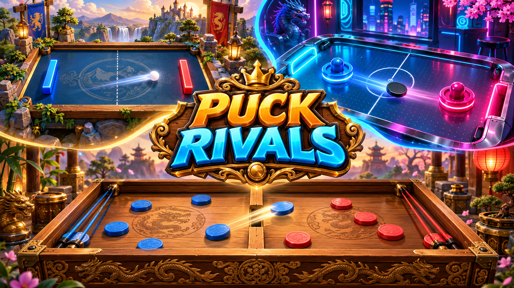
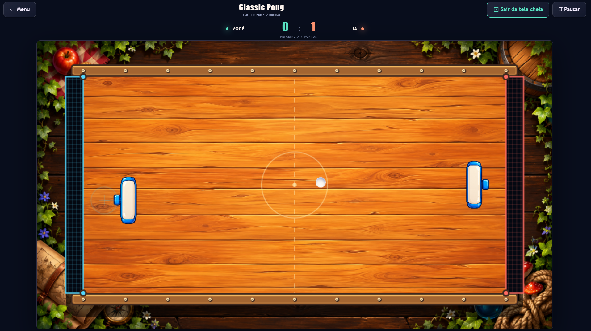
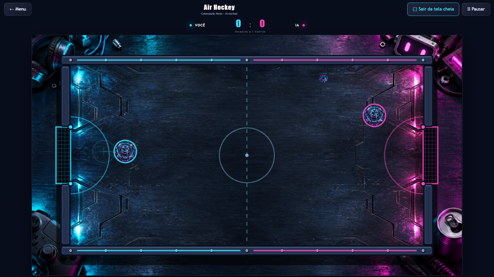
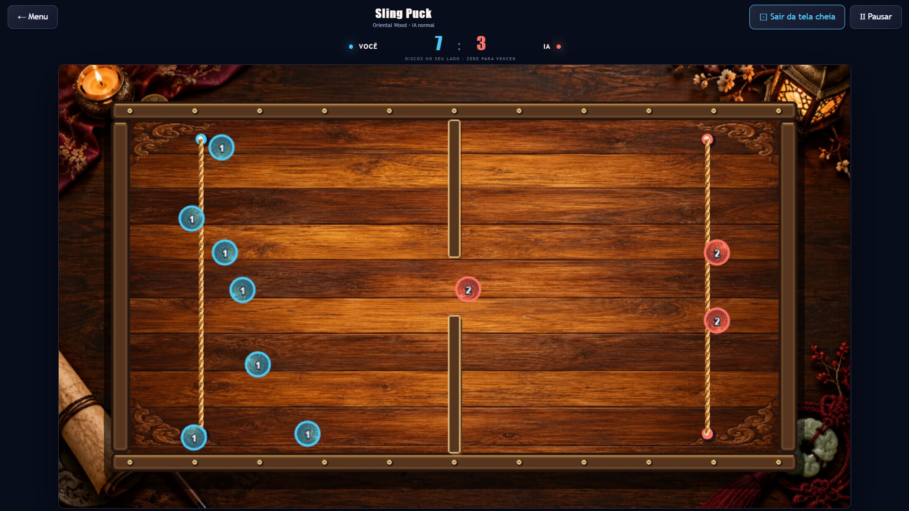

# Puck Rivals

**Três arenas. Três estilos. Uma rivalidade.**



**Puck Rivals** é uma coleção de jogos de mesa para navegador que combina reflexo, precisão e estratégia em três modalidades: **Classic Pong**, **Air Hockey** e **Sling Puck**. Jogue contra a inteligência artificial ou desafie outra pessoa no mesmo dispositivo, com controles de teclado, mouse e toque.

Cada modalidade pode ser combinada com três universos visuais: madeira oriental, aventura cartoon e arcade cyberpunk. Mesas ilustradas, peças próprias de cada tema, cenários ao redor do campo e efeitos sonoros dão identidade à experiência.

Projeto de portfólio desenvolvido em **JavaScript**, **Phaser 3** e **Vite**. A versão atual funciona localmente, sem cadastro e sem serviços de backend.

## Recursos

- Três modalidades jogáveis, com regras e física próprias.
- Adversário com IA nos níveis **fácil**, **normal** e **difícil**.
- Dupla local, incluindo toques simultâneos para os dois jogadores.
- Três temas selecionáveis para qualquer modalidade.
- Movimento livre em dois eixos, limitado à metade de cada jogador.
- Círculo de controle transparente para arrastar as raquetes sem esconder a jogada.
- Ajuste de opacidade do controle em Pong e Air Hockey.
- Placar, contagem de saque, pausa, resultado e revanche.
- Tela cheia, com alternativa que ocupa a janela quando o navegador não permite a API nativa.
- Layout responsivo, com orientação horizontal recomendada para celulares.
- Sons sintetizados, ativados após interação do jogador.

## Modalidades e gameplay

### Classic Pong

Movimente a raquete pela sua metade da mesa para interceptar a bola e encontrar o melhor ângulo de ataque. Nesta versão, a movimentação acontece tanto na horizontal quanto na vertical. A direção do rebote considera o ponto de impacto e o movimento da raquete, e a bola ganha velocidade durante as trocas.

**Como vencer:** faça a bola passar pela extremidade adversária. A partida termina com **7 ou 11 pontos**, conforme a seleção no menu.



### Air Hockey

Controle um rebatedor circular para atacar e proteger seu gol. O impacto leva em conta a velocidade do rebatedor, com movimento limitado para evitar teletransporte e impulsos irreais. O puck desliza com baixo atrito e rebate nas bordas; somente a abertura central de cada extremidade vale gol.

**Como vencer:** marque **7 ou 11 gols**. Um puck que permanece quase parado por três segundos recebe um pequeno impulso para retomar a disputa.



### Sling Puck

Cada jogador começa com cinco discos. Selecione um disco na sua metade, puxe em direção à própria borda e solte para lançá-lo pela abertura da divisória central. A corda trançada acompanha o movimento, enquanto a linha de mira indica a direção do disparo. Discos recebidos podem ser devolvidos ao rival.

Os discos da esquerda são identificados por **azul e número 1**; os da direita, por **coral e número 2**. A identificação acompanha o lado atual da peça.

**Como vencer:** coloque **os dez discos completamente no campo adversário**. A última passagem completa encerra a partida, mesmo que as peças ainda estejam em movimento. Aqui, o placar mostra os discos em cada lado: **zere o seu para vencer**.



## Temas visuais

| Tema | Identidade artística |
| --- | --- |
| **Oriental Wood** | Madeira entalhada, detalhes dourados, iluminação quente, velas, pergaminhos e objetos orientais. |
| **Cartoon Fun** | Madeira pintada, cores vivas, peças de brinquedo, plantas e objetos de aventura. |
| **Cyberpunk Neon** | Metal escuro, luzes ciano e magenta, acessórios de arcade, cabos e eletrônicos. |

Os três temas compartilham as mesmas medidas de campo, gols, passagem e pontos de fixação. A troca de tema altera a apresentação e preserva as regras e a física. Os objetos de cenário ficam atrás da mesa, sem cobrir o campo ou os controles.

## Tecnologias

| Tecnologia | Uso no projeto |
| --- | --- |
| **HTML5 e CSS3** | Estrutura do menu, interface responsiva e apresentação visual. |
| **JavaScript com ES Modules** | Regras, IA, interface e organização modular. |
| **Phaser 3** | Renderização 2D, sprites, cenas, entrada e escala do canvas. |
| **Vite** | Servidor de desenvolvimento e build de produção. |
| **Web Audio API** | Efeitos sonoros sintetizados, sem arquivos de música externos. |
| **APIs de entrada do navegador e Phaser** | Mouse, teclado, toque e caneta digital. |
| **Fullscreen API e ResizeObserver** | Ampliação da partida e ajuste do canvas. |
| **Vitest** | Testes automatizados da física e das regras. |
| **Playwright e Chromium** | Testes de integração no navegador e capturas de tela. |
| **Node.js e npm** | Ferramentas de desenvolvimento e gerenciamento de dependências. |

As ilustrações são arquivos PNG locais. Parte dos recursos visuais foi criada com **ImageGen**; os prompts e registros das artes estão documentados em `assets/`.

## Como executar

### Requisitos

- **Node.js 22.12 ou superior** — projeto validado com Node.js 24.
- **npm**, incluído no Node.js.
- **Git**, para clonar o repositório.
- Navegador moderno com suporte a Canvas/WebGL.

### Instalação

```sh
git clone https://github.com/DenilsomLobo/puck_rivals.git
cd puck_rivals
npm ci
npm run dev
```

Abra o endereço exibido pelo Vite, normalmente `http://localhost:5173`. Para testar em um celular na mesma rede, use o endereço de rede exibido no terminal. Encerre o servidor com **Ctrl+C**.

**No Windows:** dê dois cliques em [testar.cmd](./testar.cmd). O arquivo instala dependências quando necessário, executa os testes de lógica, verifica a build e abre o jogo. Se o PowerShell bloquear o script `npm.ps1`, use `npm.cmd` no lugar de `npm` nos comandos.

### Controles

| Ação | Controle |
| --- | --- |
| Mover jogador 1 em Pong/Air Hockey | **W, A, S, D** ou arrastar a raquete/círculo de controle. |
| Mover jogador 2 em dupla local | **Setas direcionais** ou arrastar o controle na metade direita. |
| Lançar no Sling Puck | Pressionar um disco, puxar para a própria extremidade e soltar. |
| Pausar a partida | Botão **Pausar** ou **Esc** na visualização normal. |
| Expandir a partida | Botão **Tela cheia**. |
| Sair da tela cheia | Botão **Sair da tela cheia** ou **Esc**. |
| Ativar/desativar áudio | Botão de som no cabeçalho do menu. |

Contra a IA, você controla o lado esquerdo. Em dupla local, cada jogador controla sua metade. O Sling Puck usa mouse, toque ou caneta para os lançamentos; essa modalidade não possui disparo por teclado.

A partida pausa ao ocultar a página ou perder o foco, e os arrastes são cancelados. Retome pelo botão **Continuar**.

## Scripts e testes

| Comando | Finalidade |
| --- | --- |
| `npm run dev` | Inicia o servidor de desenvolvimento. |
| `npm test` | Executa os testes de lógica com Vitest. |
| `npm run test:e2e` | Executa os testes de integração com Chromium. |
| `npm run build` | Gera a versão de produção em `dist/`. |
| `npm run preview` | Serve a build para conferência local. |

Antes da primeira execução dos testes de navegador, instale o Chromium usado pelo Playwright no diretório local ignorado pelo Git:

**PowerShell:**

```powershell
$env:PLAYWRIGHT_BROWSERS_PATH = "$PWD\.playwright"
npx.cmd playwright install chromium
npm.cmd run test:e2e
```

**Linux/macOS:**

```sh
PLAYWRIGHT_BROWSERS_PATH="$PWD/.playwright" npx playwright install chromium
npm run test:e2e
```

Os testes cobrem movimento, limites de velocidade, impactos, gols, passagem pela divisória, vitória do Sling Puck, IA, alinhamento das artes, revanche e tela cheia. As capturas automáticas são salvas em `test-results/`, fora do controle de versão.

## Organização do projeto

```text
puck_rivals/
├── assets/                   # Capa, gameplays, sprites, superfícies e cenários
│   └── *.md                  # Registro e prompts das artes
├── src/
│   ├── games/
│   │   ├── Simulation.js     # Regras, física e IA, independentes da interface
│   │   ├── ArenaScene.js     # Cena Phaser, controles e animação da corda
│   │   ├── ArenaArt.js       # Mesa e marcações em camadas
│   │   ├── geometry.js       # Medidas compartilhadas entre arte e colisões
│   │   └── pieceStyle.js     # Identificação visual dos jogadores
│   ├── ui/Fullscreen.js      # Tela cheia e alternativa para mobile
│   ├── art.js                # Catálogo de modalidades e recursos visuais
│   ├── physics.js            # Utilitários e configurações de dificuldade
│   ├── main.js               # Menu, áudio e ciclo de partida
│   └── *.css                 # Estilos da interface
├── tests/                    # Testes de lógica
├── e2e/                      # Testes no navegador
├── testar.cmd                # Inicialização e validação no Windows
├── vite.config.js
└── playwright.config.js
```

A simulação usa passos fixos de **1/120 s**, com subpassos de colisão para discos rápidos. A IA utiliza os mesmos limites de campo e APIs de movimento/lançamento do jogador. A geometria compartilhada mantém linhas, gols, divisória e cordas alinhados às colisões.

## Build e publicação

```sh
npm run build
npm run preview
```

A pasta `dist/` contém o site estático pronto para hospedagem. Os caminhos relativos configurados no Vite permitem integrar a build a uma subpasta, como `/games/puck-rivals/play/`.

Para integrar ao portfólio, copie somente o conteúdo de `dist/` para a pasta correspondente no projeto de hospedagem. Preserve os outros jogos e a configuração existente. O projeto não executa publicação automática nem modifica o Hosting do portfólio.

Os arquivos de build, dependências, navegadores de teste, caches e resultados dos testes são ignorados pelo Git. Código-fonte, imagens, documentação e `package-lock.json` acompanham o repositório.

## Estado atual e próximos passos

As três modalidades, os três temas, a IA e a dupla local estão disponíveis. A execução local não exige cadastro, credenciais ou Firebase. Após instalar as dependências, o jogo servido localmente não depende de serviços externos.

**Ainda não implementados:** multiplayer online, salas privadas, sincronização Firebase, espelhamento, instalação PWA e cache para jogar após fechar o servidor. A dupla atual funciona no mesmo dispositivo.

Próximas melhorias incluem otimizar o peso dos PNGs e do pacote de renderização, ampliar a validação em dispositivos móveis reais e desenvolver o multiplayer online. A build atual pode emitir aviso de tamanho do pacote Phaser; isso não impede sua geração.

## Autoria

Desenvolvido por **Denilsom Lobo** — [DenilsomLobo no GitHub](https://github.com/DenilsomLobo).

Repositório: [DenilsomLobo/puck_rivals](https://github.com/DenilsomLobo/puck_rivals).
